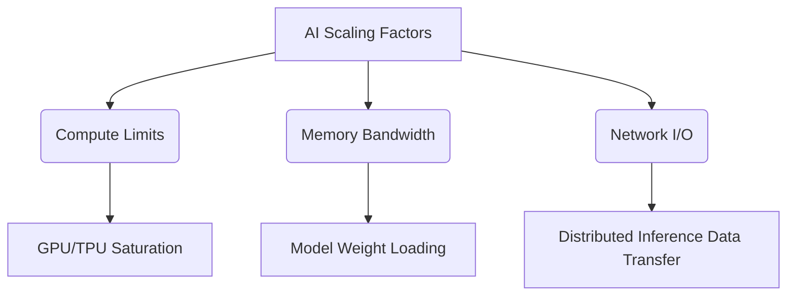
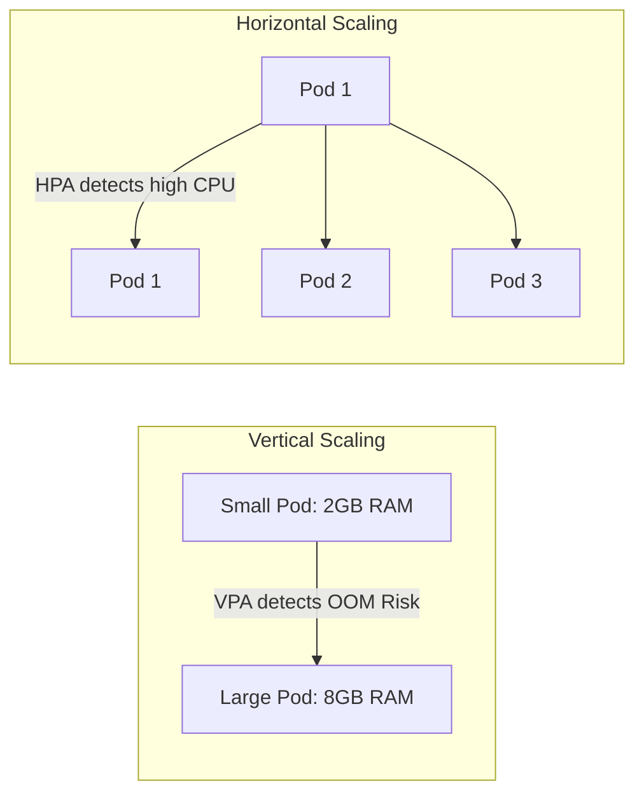

# SCALING STRATEGIES FOR AI SYSTEMS

**Session Time:** 120 minutes

---

## Table of Contents
1. Introduction to AI Scalability
2. Key Factors Influencing Scalability
3. Configuring Horizontal and Vertical Scaling
4. Assessing Trade-Offs (Cost vs. Performance)
5. Lab: Container Build Challenge
6. Wrap-Up and Reflection

---

## Learning Objectives

By the end of this module, participants will be able to:

1. **Identify** key factors influencing scalability in AI infrastructures.
2. **Configure** horizontal and vertical scaling mechanisms in cloud environments.
3. **Assess** the trade-offs between scalability, performance, and cost.

---

## Session Breakdown

| Segment | Topic                                         | Duration (minutes) |
|---------|-----------------------------------------------|--------------------|
| 1       | Key Factors in AI Scalability                 | 20                 |
| 2       | Horizontal vs. Vertical Scaling Mechanisms    | 20                 |
| 3       | Trade-offs: Cost, Performance, and Efficiency | 20                 |
| 4       | Lab: Container Build Challenge                | 60                 |

---

## 1. Key Factors Influencing Scalability

Scaling an AI system is fundamentally different from scaling a traditional web application. Professionals must transition from thinking solely about CPU and RAM to managing specialized hardware accelerators (GPUs/TPUs), massive memory bandwidth requirements for model weights, and network I/O for distributed inference. 

### Key Influencing Factors:
* **Model Size and Architecture:** Large Language Models (LLMs) often exceed the memory capacity of a single GPU, requiring model sharding across multiple nodes.
* **Inference Latency vs. Throughput:** Real-time AI (fraud detection) requires low latency, while batch processing (nightly recommendation updates) prioritizes throughput.
* **Data Locality:** Moving gigabytes of data to compute nodes introduces network bottlenecks.

### Tool: `kubectl` (Observability)
Before you can scale, you must understand your current resource bottlenecks. `kubectl` allows engineers to inspect real-time resource consumption on a Kubernetes cluster.

**Practical Example:**
Using `kubectl top` to identify if an AI inference pod is maxing out its allocated CPU or Memory, signaling the need for scaling.

```bash
# Check resource usage across all nodes in the cluster
kubectl top nodes

# Identify specific AI pods that are bottlenecking
kubectl top pods --namespace ai-production

```



---

## 2. Configuring Horizontal and Vertical Scaling

Once bottlenecks are identified, engineers must apply the correct scaling strategy.

* **Vertical Scaling (Scaling Up):** Adding more power (CPU, RAM, larger GPUs) to an existing machine or pod.
* **Horizontal Scaling (Scaling Out):** Adding more instances (pods or nodes) to distribute the load.

### Tools: Kubernetes & Minikube

Kubernetes automates these processes using the **Horizontal Pod Autoscaler (HPA)** and **Vertical Pod Autoscaler (VPA)**. Minikube provides a local environment to test these mechanisms safely before cloud deployment.

**Practical Example:**
Configuring a Kubernetes HPA to automatically scale an AI model's deployment based on CPU utilization. If the traffic spikes and CPU exceeds 70%, Kubernetes will provision more pods.

```yaml
# hpa-ai-service.yaml
apiVersion: autoscaling/v2
kind: HorizontalPodAutoscaler
metadata:
  name: ai-inference-hpa
spec:
  scaleTargetRef:
    apiVersion: apps/v1
    kind: Deployment
    name: ai-inference-deployment
  minReplicas: 2
  maxReplicas: 10
  metrics:
  - type: Resource
    resource:
      name: cpu
      target:
        type: Utilization
        averageUtilization: 70

```



---

## 3. Objective 3: Assessing Trade-Offs (Cost vs. Performance)

Automation is powerful, but unrestricted scaling leads to massive cloud bills. A reliability engineer must balance efficiency, cost, and performance across distributed environments.

### The Trade-Off Triangle

1. **Performance (Speed):** Achieved by keeping warm instances ready and over-provisioning.
2. **Cost (Budget):** Achieved by scaling down to zero during idle times or using Spot Instances.
3. **Reliability (Uptime):** Achieved by distributing workloads across multiple Availability Zones (AZs).

### Tool: Kubernetes (Resource Quotas & Limits)

Kubernetes allows administrators to enforce cost-control boundaries using Resource Quotas at the namespace level, preventing a rogue autoscaler from draining the budget.

**Practical Example:**
Setting strict Resource Limits on a container. If an AI model attempts to consume more memory than allowed (perhaps due to a memory leak during inference), Kubernetes will terminate the pod (OOMKilled) rather than letting it starve other critical services.

```yaml
resources:
  requests:
    memory: "4Gi"
    cpu: "2"
  limits:
    memory: "8Gi"
    cpu: "4"

```

---

## 4. Lab: Container Build Challenge

**Objective:** Containerise a web app using Docker to ensure consistent execution across environments. Learners strengthen understanding of portability and reproducibility.

*(Refer to external lab documentation for full hands-on instructions).*

---

## 5. Wrap-Up and Reflection

**Reflection Questions:**

1. Why is horizontal scaling generally preferred over vertical scaling for stateless AI inference APIs?
2. How do Kubernetes resource `requests` versus `limits` impact the predictability of your cloud infrastructure costs?
3. If an AI model requires an 80GB GPU to load its weights, how does this constraint impact your ability to use the Horizontal Pod Autoscaler?

---

## Resources

* **Kubernetes Autoscaling:** [HPA Documentation](https://kubernetes.io/docs/tasks/run-application/horizontal-pod-autoscale/)
* **Managing Compute Resources:** [Resource Management for Pods and Containers](https://kubernetes.io/docs/concepts/configuration/manage-resources-containers/)
* **Minikube Metrics Server:** [Enabling Metrics Server in Minikube](https://www.google.com/search?q=https://minikube.sigs.k8s.io/docs/handbook/addons/metrics-server/)
